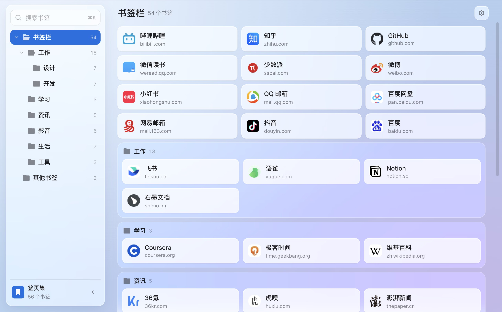
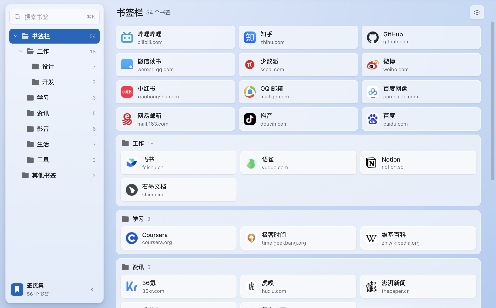
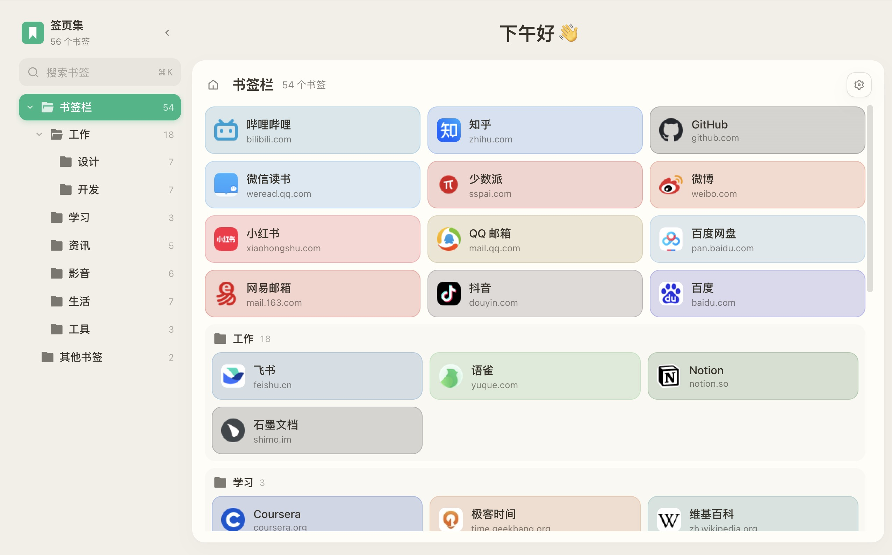
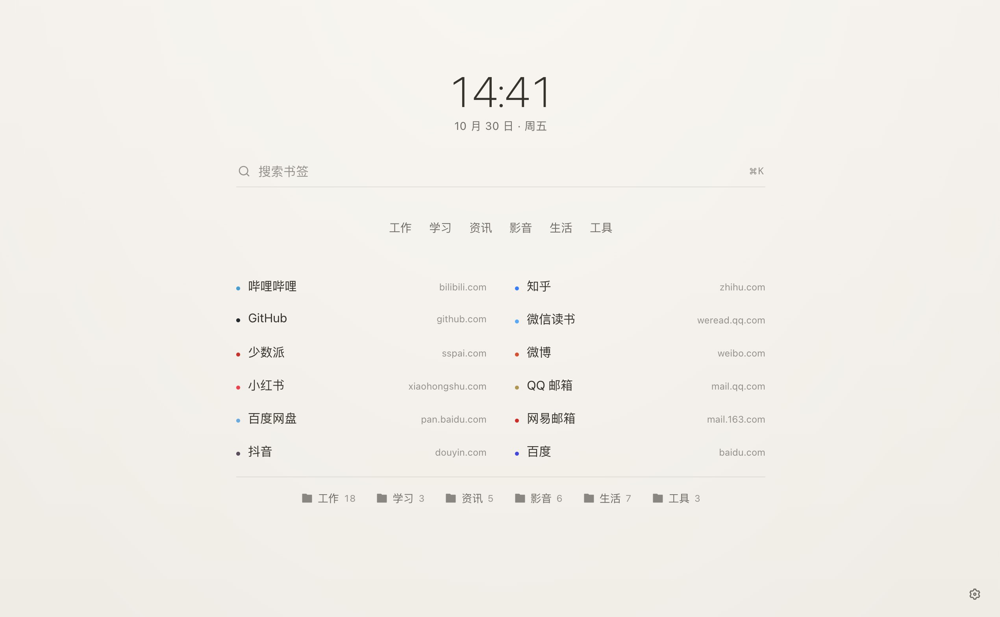
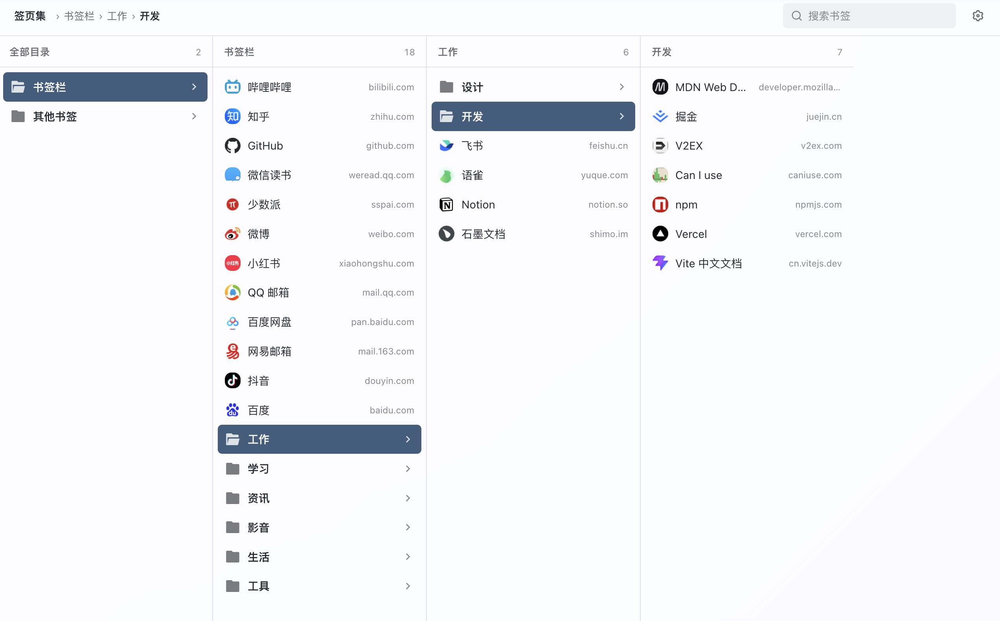
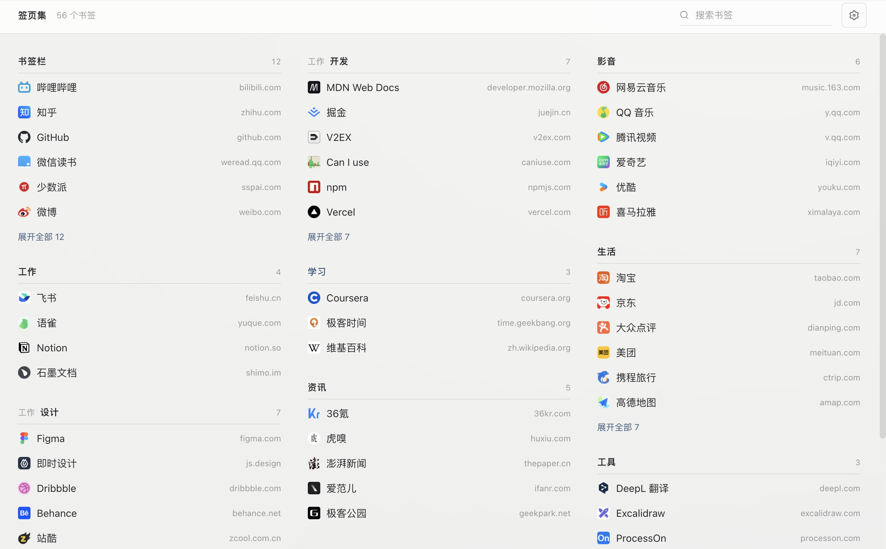
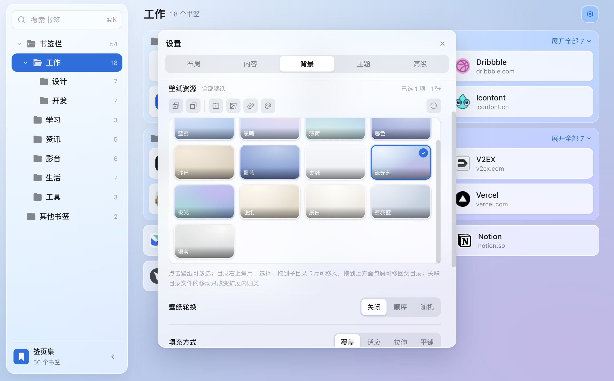
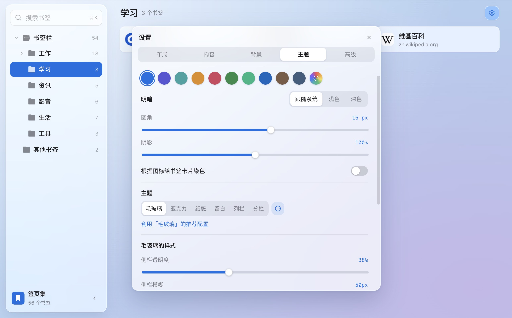

<div align="center">
  
  <h1>Tabfolio</h1>
  <p>Your bookmarks, arranged your way.</p>
  <p>
    
    
    <a href="LICENSE"></a>
  </p>
  <p><a href="README.md">简体中文</a> · <b>English</b></p>
</div>

<p align="center">
  
</p>

Tabfolio is a new tab extension for Chrome and Edge. It reads the bookmarks already in your browser and lays them out by folder on the new tab page. There is nothing to import and no account to create.

Screenshots show the Chinese interface. The extension is fully available in English.

## Features

### 🎨 Six themes

Each theme has its own page layout, not just a different color scheme.

<table>
  <tr>
    <td width="50%" valign="top"><br><b>Frosted glass</b>: folder tree on the left, bookmarks in the middle, Most visited and Recently added on the right, on translucent panels over your wallpaper.</td>
    <td width="50%" valign="top"><br><b>Acrylic</b>: the Windows 11 acrylic material, translucent with an accent tint and fine grain.</td>
  </tr>
  <tr>
    <td width="50%" valign="top"><br><b>Paper</b>: bookmarks sit on an opaque sheet, with layers told apart by shades of the background.</td>
    <td width="50%" valign="top"><br><b>Whitespace</b>: a clock, a search box and your bookmarks in one centered column, with no panels or cards.</td>
  </tr>
  <tr>
    <td width="50%" valign="top"><br><b>Columns</b>: click down through folders as in Finder's column view. Good for deeply nested collections.</td>
    <td width="50%" valign="top"><br><b>Columnar</b>: several folders side by side in columns, so one screen shows the contents of many folders.</td>
  </tr>
</table>

When you switch themes, Tabfolio lists the colors, corner radius, card size and other settings the theme recommends. Only the items you tick are applied, so settings you have already adjusted stay as they are.

### 📚 Manage your browser bookmarks

- Drag cards to reorder them, or drop them on a folder to move them in
- Right-click to change a name, URL or folder, delete a bookmark, or open a whole folder at once
- Pin a folder you use often so every new tab opens on it
- Every change is made to your browser bookmarks directly, so the browser's own bookmark manager stays in step

### 🗂️ Folder display

Subfolders can be hidden, shown as usual, pinned to the top, or expanded in place. The next level down can have its own setting, up to five levels deep.

### 🔍 Search and frequent sites

- Press <kbd>⌘</kbd> <kbd>K</kbd> (<kbd>Ctrl</kbd> <kbd>K</kbd> on Windows and Linux) to search bookmark titles and URLs, optionally within the current folder only
- The Frosted glass, Acrylic and Paper themes show Most visited and Recently added lists
- Hold <kbd>⌘</kbd> or <kbd>Ctrl</kbd> while clicking a bookmark to open it in a new tab

### 🖼️ Wallpapers

- A set of built-in gradients, plus a gradient editor for making your own
- Upload local images or add image URLs, and sort them into folders
- Link an image folder on your computer, then refresh it when files are added or removed
- Bing daily wallpaper, which needs separate permission to access bing.com
- Rotate in order or at random, on a timer or each time you open a new tab
- Blur, dimming, and cover, contain, stretch or tile fitting

<p align="center">
  
</p>

### ✨ Appearance

- Accent color, light or dark mode (or follow the system), corner radius and shadow
- Card width and height, content width, and the transparency and blur of materials such as frosted glass and acrylic
- Use your own image as a bookmark icon. If a folder name starts with an emoji, such as "📁 Work", that emoji becomes the folder icon
- Tint bookmark cards automatically with the color of each site's icon
- Custom CSS, with stable class names on interface elements

<p align="center">
  
</p>

### 🔒 Sync and privacy

- Settings sync across devices through your browser account. You can turn this off in settings
- The extension has no server of its own. Bookmarks, settings, local images and visit counts are never sent to the developer, and there are no analytics or ads
- No website access is requested by default. Showing site icons needs the `favicon` permission, which may cause the browser to show a warning about browsing history, but the extension does not read your history
- Most visited only counts bookmarks opened through Tabfolio, and the counts stay on your device
- Local images are stored only on the current device and are not synced

See the [privacy policy](PRIVACY.md) for details.

### 🌐 Languages

English and Simplified Chinese. The interface follows your browser language by default, and you can change it in settings.

## Installation

Requires Chrome or Edge 114 or later.

1. Download the latest `tabfolio-x.x.x.zip` from [Releases](../../releases) and unzip it
2. Open `chrome://extensions` (`edge://extensions` in Edge) and turn on Developer mode
3. Click "Load unpacked" and select the unzipped folder

When you open a new tab, the browser may ask whether to keep the change made by the extension. Choose to keep it. On first use, Tabfolio shows a data handling notice and only reads your bookmarks after you agree.

## Development

Requires Node.js 18 or later.

```bash
npm install
npm run dev
```

Then open http://localhost:5173/newtab.html. A regular web page has no `chrome.*` API, so the page switches to built-in sample bookmarks and `localStorage`. You can work on the interface without installing the extension.

| Command | Description |
| --- | --- |
| `npm run dev` | Start the dev server |
| `npm run build` | Build into `dist/`, which can be loaded directly as an unpacked extension |
| `npm run watch` | Rebuild `dist/` whenever the code changes |
| `npm run pack` | Build and package a zip into `release/` |
| `npm run typecheck` | Run the type checker |

## License

[MIT](LICENSE)
