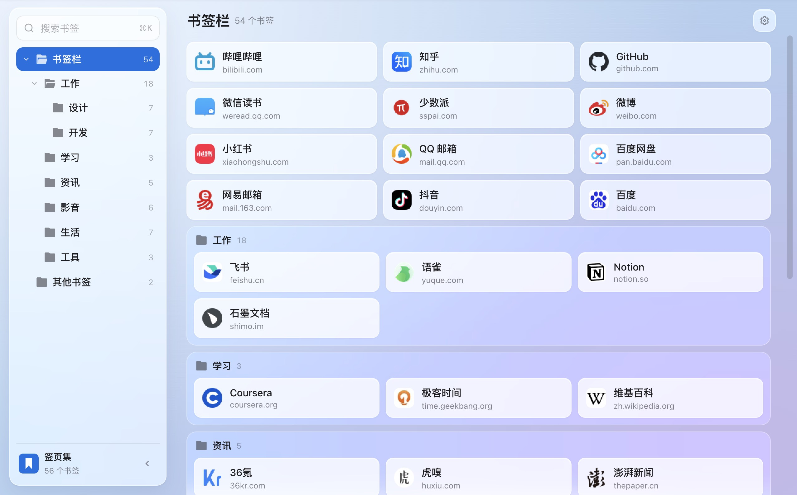
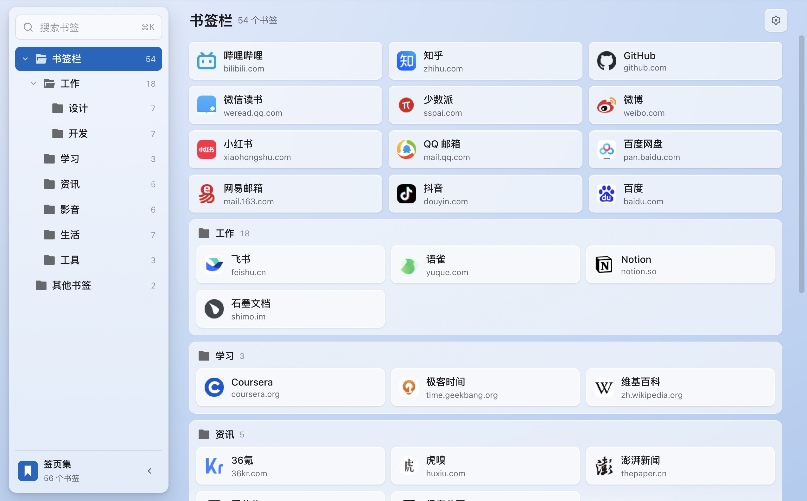
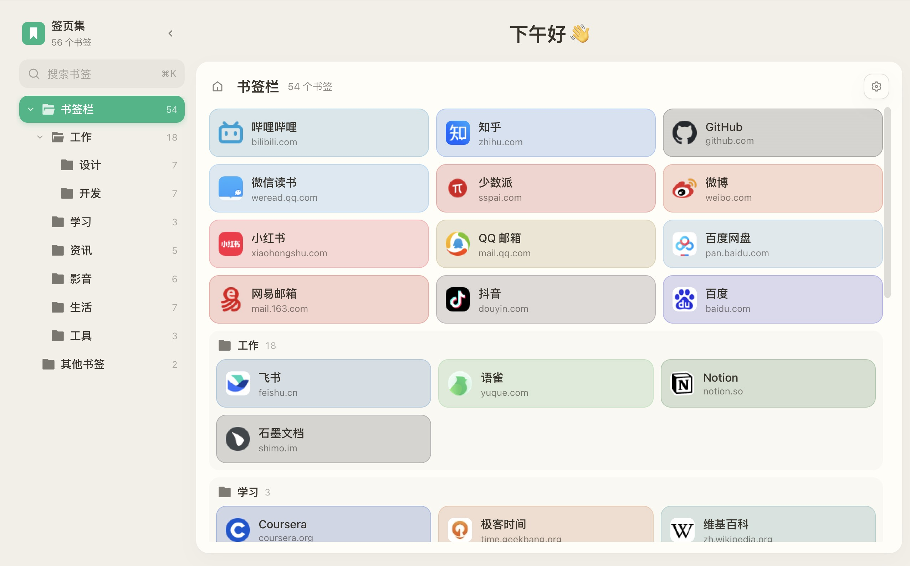
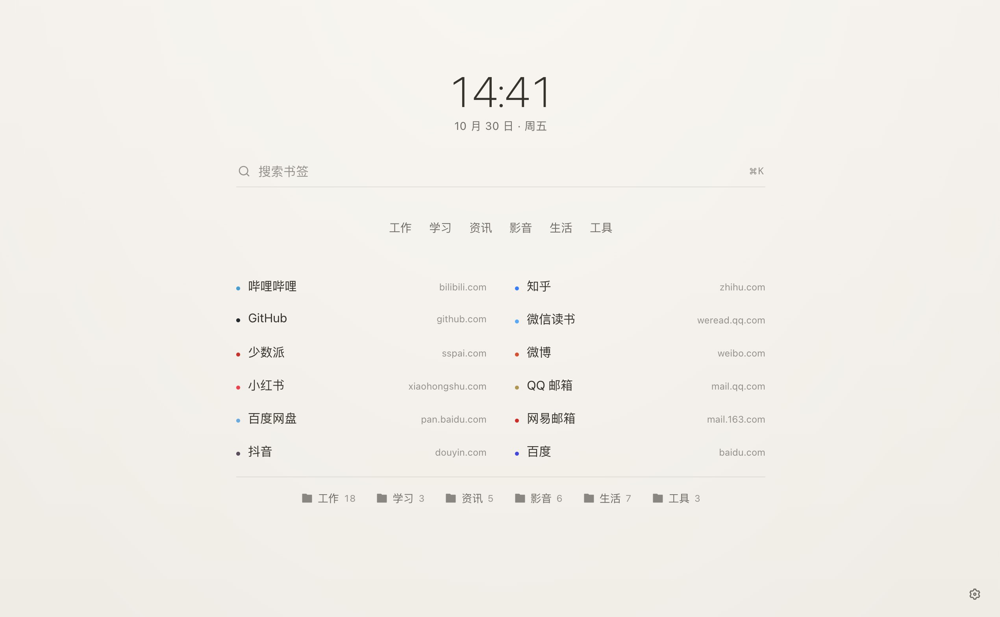
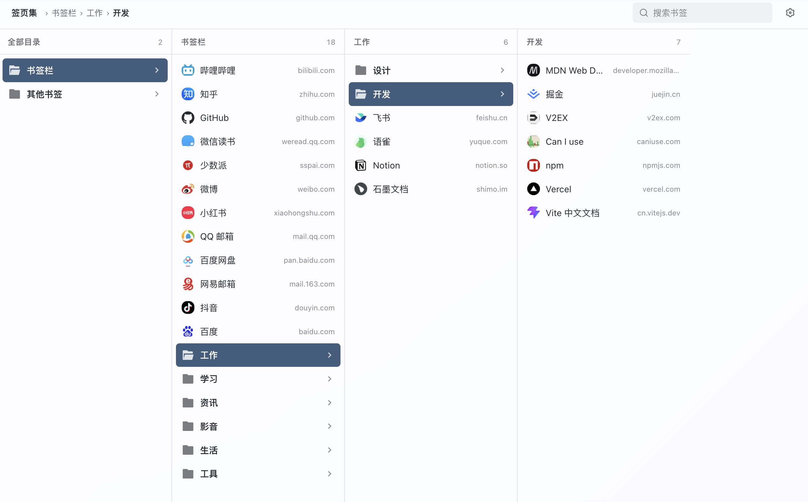
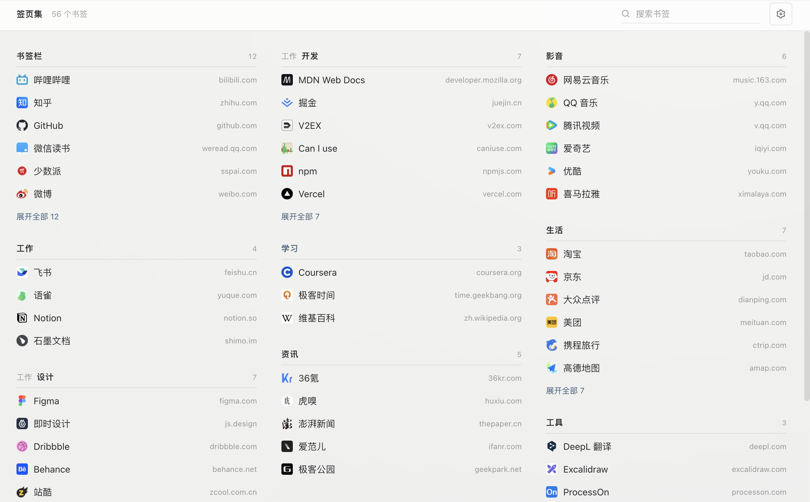
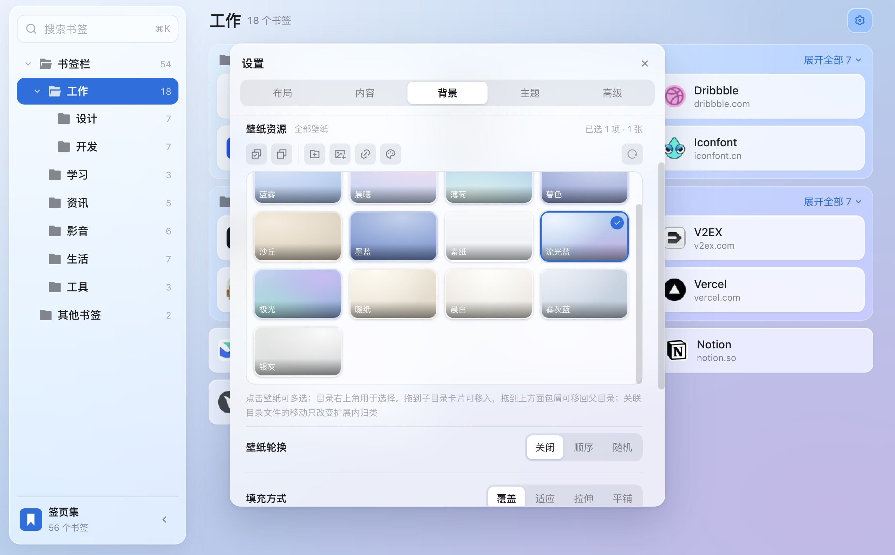
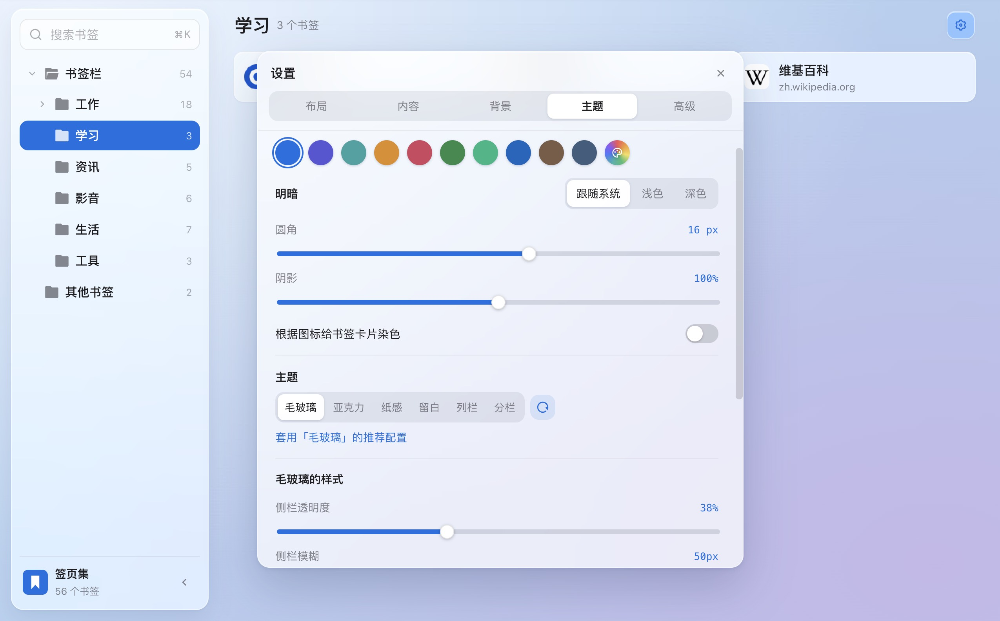

<div align="center">
  
  <h1>签页集</h1>
  <p>把书签，摆成你喜欢的样子。</p>
  <p>
    
    
    <a href="LICENSE"></a>
  </p>
  <p><b>简体中文</b> · <a href="README.en.md">English</a></p>
</div>

<p align="center">
  
</p>

签页集是一个 Chrome / Edge 新标签页扩展。它直接读取浏览器里已有的书签，在新标签页上按目录展示。不用导入，也不用注册账号。

## 功能

### 🎨 六套主题

每套主题的页面布局都不一样，不只是换一套配色。

<table>
  <tr>
    <td width="50%" valign="top"><br><b>毛玻璃</b>：左边目录树，中间书签，右边是最常访问和最近添加。半透明面板下透出壁纸。</td>
    <td width="50%" valign="top"><br><b>亚克力</b>：Windows 11 风格的亚克力材质，半透明，带主色色调和细微噪点。</td>
  </tr>
  <tr>
    <td width="50%" valign="top"><br><b>纸感</b>：书签放在一张不透明的纸面上，用底色深浅区分层次。</td>
    <td width="50%" valign="top"><br><b>留白</b>：时钟、搜索框和书签排在页面正中的一栏里，没有面板，也没有卡片。</td>
  </tr>
  <tr>
    <td width="50%" valign="top"><br><b>列栏</b>：和访达的分栏视图一样逐级点进去，适合层级很深的收藏。</td>
    <td width="50%" valign="top"><br><b>分栏</b>：多个目录并排成几栏，一屏能看到许多目录的内容。</td>
  </tr>
</table>

切换主题时，会列出这套主题推荐的配色、圆角、卡片尺寸等设置，勾选的项目才会应用，已经调好的设置不会被覆盖。

### 📚 管理浏览器书签

- 拖动卡片可以排序，拖到目录上可以移进去
- 右键可以修改名称、网址和所在目录，删除书签，或者一次打开整个目录
- 常用的目录可以钉住，每次打开新标签页都停在这里
- 所有修改都直接作用在浏览器书签上，和浏览器自带的书签管理器保持一致

### 🗂️ 目录展示

子目录可以设为隐藏、默认、置顶或展开，下一级子目录还能单独设置，最多五层。

### 🔍 搜索与常用

- 按 <kbd>⌘</kbd> <kbd>K</kbd>（Windows 和 Linux 上是 <kbd>Ctrl</kbd> <kbd>K</kbd>）搜索书签标题和网址，可以只搜当前目录
- 毛玻璃、亚克力和纸感主题有「最常访问」和「最近添加」两个列表
- 按住 <kbd>⌘</kbd> 或 <kbd>Ctrl</kbd> 点击书签，会在新标签页打开

### 🖼️ 壁纸

- 内置一组渐变壁纸，也可以用渐变编辑器自己调
- 上传本地图片或填写图片网址，按目录整理
- 关联电脑上的图片文件夹，文件有增减时手动刷新一下
- Bing 每日壁纸，需要单独授权访问 bing.com
- 按顺序或随机轮换，可以定时切换，也可以每次打开新标签页时换
- 支持模糊、压暗，以及覆盖、适应、拉伸、平铺四种填充方式

<p align="center">
  
</p>

### ✨ 外观

- 主色、浅色或深色（也可以跟随系统）、圆角、阴影
- 卡片宽高、内容区宽度，以及毛玻璃、亚克力等材质的透明度和模糊程度
- 书签图标可以换成自己的图片；目录名以 emoji 开头时（如「📁 工作」），这个 emoji 会作为目录图标
- 书签卡片可以按网站图标的颜色自动着色
- 支持自定义 CSS，界面元素都有固定的类名

<p align="center">
  
</p>

### 🔒 同步与隐私

- 设置通过浏览器账号在设备间同步，可以在设置里关闭
- 扩展没有自己的服务器，书签、设置、本地图片和访问次数都不会发给开发者，也没有统计和广告
- 默认不申请任何网站访问权限。显示网站图标需要 `favicon` 权限，浏览器可能因此给出与浏览记录相关的提示，但扩展不读取浏览历史
- 「最常访问」只统计通过签页集打开书签的次数，数据留在本机
- 本地图片只保存在当前设备，不参与同步

详见[隐私权政策](PRIVACY.md)。

### 🌐 语言

支持简体中文和英文，默认跟随浏览器，也可以在设置里切换。

## 安装

需要 Chrome 或 Edge 114 及以上版本。

1. 在 [Releases](../../releases) 下载最新的 `tabfolio-x.x.x.zip` 并解压
2. 打开 `chrome://extensions`（Edge 是 `edge://extensions`），开启「开发者模式」
3. 点击「加载已解压的扩展程序」，选择解压后的文件夹

打开新标签页时，如果浏览器询问是否保留扩展做出的更改，选择保留。第一次使用会先显示数据处理说明，同意之后才会读取书签。

## 开发

需要 Node.js 18 或以上版本。

```bash
npm install
npm run dev
```

然后访问 http://localhost:5173/newtab.html。普通网页里没有 `chrome.*` API，页面会改用内置的示例书签和 `localStorage`，不装扩展也能调试界面。

| 命令 | 说明 |
| --- | --- |
| `npm run dev` | 启动开发服务器 |
| `npm run build` | 构建到 `dist/`，可以直接作为已解压的扩展程序加载 |
| `npm run watch` | 监听代码变化，自动重新构建 `dist/` |
| `npm run pack` | 构建并打包成 zip，输出到 `release/` |
| `npm run typecheck` | 类型检查 |

## 许可

[MIT](LICENSE)
